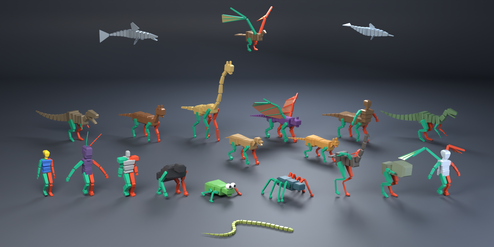
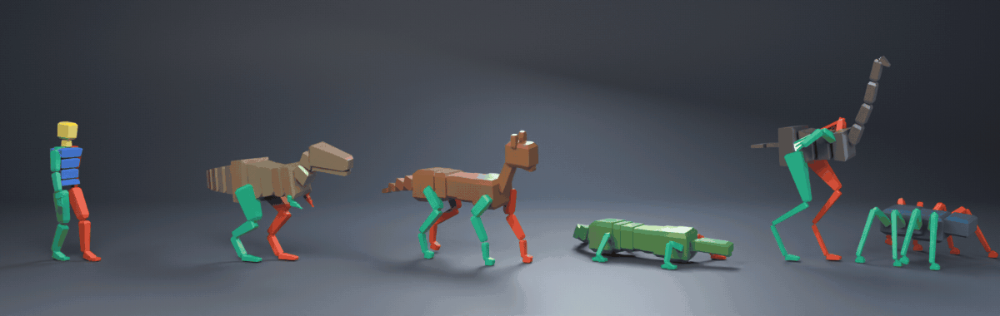
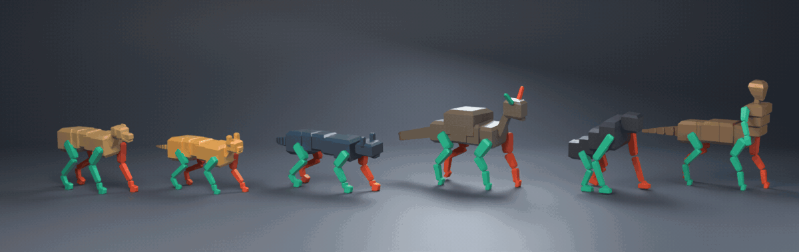
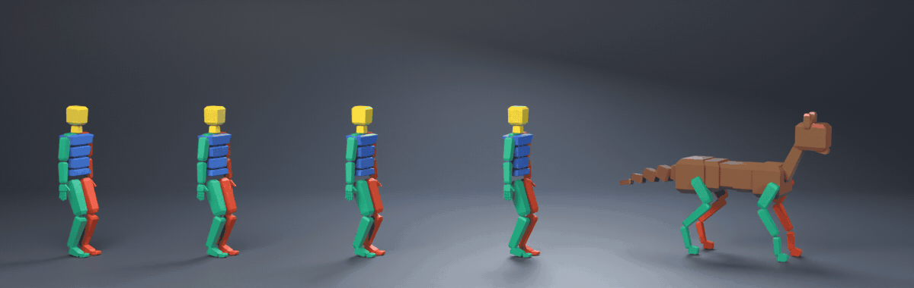
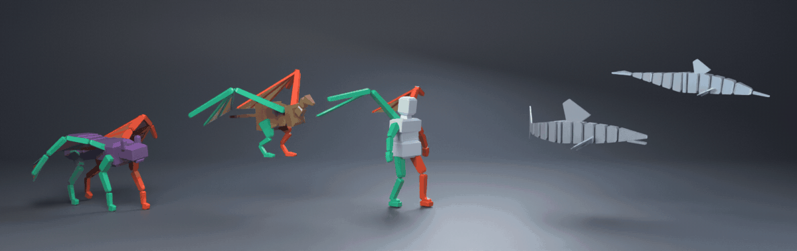
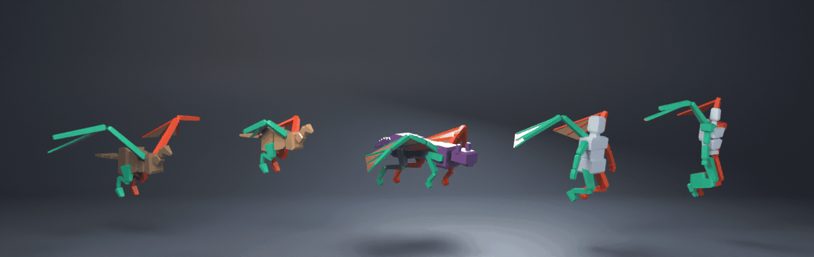
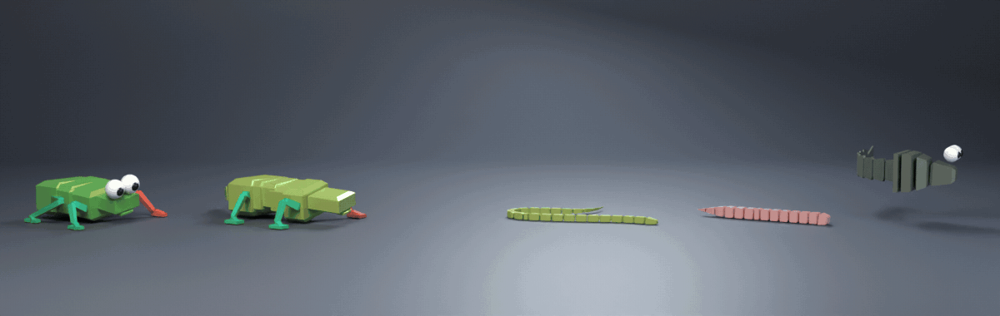
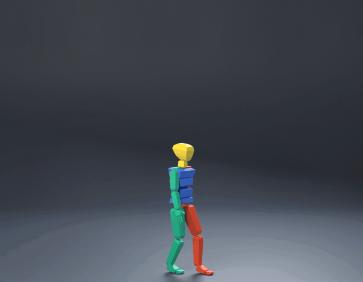

# Chimera Kit

Build a creature, press play, and reshape it while it walks.

Chimera Kit is a Blender add-on for parametric creature rigs and procedural animation. Pick one of 38 presets and it is built on the spot, drag sliders to change its proportions, and generate walk, idle, jump, punch, kick, swim or fly cycles that update live as you tune them. Then send the motion to your own character, or bring Mixamo motion in.



Current version: **1.7.0** ([changes](CHANGELOG.md)).

It is inspired by the Biped and CAT workflows that 3ds Max animators grew up with: a box figure you can pose in minutes, footsteps you can drag around, and motion you layer on top. It is an independent project, written from scratch for Blender.

## See it move

**Walk cycles.** Every preset walks out of the box, with a gait that suits its body: bipeds stride, the horse folds its legs at the elbow and hock, the lizard sprawls and bends its spine, the spider walks on alternating legs.



**Four legs.** Dogs, cats and panthers, a gnu, a knuckle-walking gorilla and a centaur, each with its own stance and stride.



**Idle, jump, punch and kick.** Game-ready cycles with their own controls: jump height and crouch depth, strike side and height.



**Wings and swimmers.** Five wing motions (flap, glide, hover, flutter, folded), and winged creatures beat their wings while they walk. Fish beat their tails side to side; dolphins and whales beat theirs up and down.



**Flight.** The Fly cycle lifts a creature off the ground, tucks its legs and lets the body ride each wing beat. Set the wings to Glide and it soars.



**Crawlers and swimmers without legs.** The snake slithers in travelling waves, the worm arches like an inchworm, the frog bounds, and cartoon eyeballs bounce along behind the head.



**Parametric bodies.** Body sliders stay live after the creature is built. Leg length, neck length and links, body width, arm length, head size and accessories all reshape the rig in place, and the cycle regenerates to fit.



MP4 versions of every loop are in [`media/`](media).

## Features

### Creatures

- **38 presets in seven families.** Humanoids and primates (Biped, Human, Ape, Gorilla, Alien, Angel, Centaur), mechs (Classic, Trooper, Flyer, Walker pod), four legs (Horse, Gnou, Giraffe, Panther, Dog, Cat, Dragon), reptiles, amphibians and dinosaurs (Lizard, Gecko, Frog, Snake, Allosaur, T-Rex, Brontosaurus), birds (Bird, Eagle, Ostrich, Penguin), swimmers (Fish, Shark, Dolphin, Whale, Tadpole) and bugs and crawlers (Spider, Crab, Centipede, Worm).
- **A box-figure Biped.** Centre-of-mass control, pelvis, spine links, clavicles, arms, five three-link fingers, legs and toes, colour-coded red on the left and green on the right, with a blue body and a yellow head. Any preset can be drawn as flat-shaded boxes or rounded shapes.
- **Presets build on the spot.** Pick one and it appears. The creature it replaces is removed if you have not worked on it yet, or hidden and kept if you have. **Build another creature** adds one alongside, and the bin next to the creature chooser deletes the active one.
- **Live body sliders.** Size, body length and width, leg, arm and neck length, head size, and the number of leg pairs, spine, neck and tail links. Ranges are wide on purpose: body length goes to 40× and neck length to 80×, for eels with legs and anything else you can think of.
- **Trunk shape.** Chest, belly and hip sliders give a deep chest and tucked waist, a horse's barrel, a pot belly, or anything between; chest width and hip width move the arms and legs in and out with them. **Natural curve** sets the S of the spine and the bow of the neck.
- **Hands, feet and heads.** Hand size; foot length and foot thickness as separate sliders; an arm rest pose from relaxed to a T; and a head shape from a plain block to a human head with a chin and a rounded skull.
- **Stance.** Separate height sliders for the front and hind legs, for a gorilla's high shoulders or a hot rod's raised rear.
- **Accessories for any creature.** Tail (links and length), wings (span and 2 to 12 joints), antennae (length and links), ponytail, a hinged jaw and cartoon eyeballs you can place: spacing, height, how far forward, and size. Wings can be angled up from the shoulder and raised.
- **Real IK rigs.** IK feet with knee poles, FK spine and arms, custom control shapes. Fit the skeleton to your own mesh, then bind it with automatic weights.

### Animation

- **Procedural cycles.** Walk (four gaits: walk, trot, pace, bound), idle, jump, punch, kick, swim, slither and fly. Each one is an ordinary Blender action you can keep editing by hand.
- **Live tuning.** Stride, lift, timing, body bounce and sway, hip twist with counter-rotating chest, spine bend and flex, head bob, arm swing, foot roll, tail dynamics, wing beat, a jaw that opens on some cycles, and follow-through on antennae, ponytails and eyeballs. Change a slider and the playing cycle updates.
- **Motion styles.** Neutral, Sneak, Heavy, Cartoon and Run, plus an exaggeration dial.
- **Editable footsteps.** Lay down footstep markers for a travelling walk, then move them. Feet land on the markers and the body follows the path they imply, so turning a run of steps turns the walk, and raising them makes it climb. Works with Blender's proportional editing for soft falloff.
- **Path following.** Walk along any curve with planted feet.
- **Animation layers.** Generate a base cycle, add tail-only or upper-body overlays, and blend them with weights and fades on Blender's NLA.
- **Per-limb timing.** Phase and lift for each leg.

### Retargeting

- **Mixamo import.** Load a Mixamo FBX and map it onto a creature in one step. Feet land on IK controls and knee poles, so the result stays editable.
- **Send motion to CloudRig-style control rigs.** Generated walks, layers and footsteps are keyed onto FK controls, IK feet, knee poles and the torso control of a production rig.
- **Any skeleton to any skeleton.** Bones are recognised by name (Mixamo, Unreal-style, Rigify-style and CloudRig-style conventions) and by where they sit in the body. The bone map is an editable table you can save and reload.
- **Different rest poses and sizes are handled.** A T-pose source drives an A-pose target; travel and foot height are scaled by leg length and measured from the ground, so planted feet stay planted.

### Export

- **Game-ready clips.** GLB and FBX export, with every cycle you generated for a creature written as its own animation clip.
- **Recipes.** Save a creature and its motion settings as JSON and load them on another machine.

### Experimental: mesh from skeleton

The Build tab can also wrap a creature's skeleton in a skinned, all-quad mesh that follows the body sliders, and two-legged creatures with arms can wear a fitted human base model (741 or 1,591 vertices) instead. This part is still being refined and is marked experimental in the sidebar; the pictures on this page show the mannequins, not these meshes.

## Install

1. Download [`Chimera_Kit.zip`](Chimera_Kit.zip) from this repository.
2. In Blender: **Edit › Preferences › Add-ons › Install from Disk**, choose the zip, and enable **Chimera Kit**.
3. Open the sidebar in the 3D View (press **N**) and select the **Chimera Kit** tab.

Requires Blender 4.2 or newer. Development and testing are on Blender 5.1.

## Quick start

1. **Build.** Choose a preset; it is built right away. Drag any body slider to reshape it.
2. **Animate.** Switch to the Animate tab, press **Generate walk**, then **Play**. Move any slider in Cycle or Motion tuning and watch the walk change.
3. **Try another cycle.** Pick Idle, Jump, Punch, Kick or Fly and generate again. Each becomes its own action.
4. **Retarget.** In the Retarget tab, choose where motion comes from and what it applies to, press **Auto-map bones**, check the table, then **Retarget motion**.
5. **Export.** In the Export tab, press **Export GLB** or **Export FBX**.

The sidebar is organised into five workflow tabs: Build, Animate, Layers, Retarget and Export. The Build tab runs in numbered steps: 1 · Creature skeleton, 2 · Mesh from skeleton (experimental), 3 · Skin your own mesh.

## Status

This is a young project and parts of it are less proven than others.

- The automated tests cover rig building for all presets, every cycle type, live updates, footsteps, layers, retargeting and export. They run in background Blender 5.1.
- **Mixamo** retargeting is tested with a Mixamo-named skeleton round-tripped through FBX. Files downloaded from Mixamo have not been verified yet.
- **CloudRig** retargeting is tested against a stand-in rig built with CloudRig's naming conventions, not yet against a rig generated by the CloudRig add-on. If Auto-map misses controls on your rig, fill them in from the bone map table, and please open an issue with the control names.
- Retargeted arms are keyed on FK controls only. IK hand controls are not keyed, and the target rig's IK/FK switches are not changed for you.
- Punch and kick are a first pass with one fixed timing shape.
- Flight is a first pass: upright humanoids hover more than they fly, and there is no banking or take-off and landing.
- Mesh from skeleton is experimental: shoulders, hands, feet and the joins between legs and body are still being refined.
- There is no terrain collision or crowd system.

Bug reports and rig files that break the bone mapper are very welcome.

## Tests

Each suite runs in background Blender:

```
blender --background --factory-startup --python-exit-code 1 --python tests/smoke_blender.py
```

The suites are `smoke`, `creatures`, `cycles`, `parts`, `live`, `livebody`, `features`, `workflows`, `layer_evaluation`, `presets`, `mesh`, `package` and `retarget`. The `package` suite opens a demo scene, so run `scripts/create_demo.py` once before it. The pictures above are rendered by `scripts/render_showcase.py`, and `scripts/build_release.py` rebuilds the installable zip.

## Credits and names

Chimera Kit is not affiliated with or endorsed by Autodesk, Adobe or the Blender Foundation. Early versions of this project were called Character Studio for Blender; recipes and bone maps saved by them still load. 3ds Max, Character Studio and CAT are Autodesk products; Mixamo is an Adobe service; CloudRig is developed by Blender Studio. Those names are used here only to describe compatibility and inspiration. No code or assets from those products are included.

The human base models are the MakeHuman light proxies `proxy741` and `male1591`, fitted with MakeHuman's HM08 skeleton and weights, all released as CC0 by the MakeHuman project; see [licenses/MakeHuman-CC0.md](licenses/MakeHuman-CC0.md). `tools/make_templates.py` regenerates them.

## License

MIT. See [LICENSE](LICENSE).
